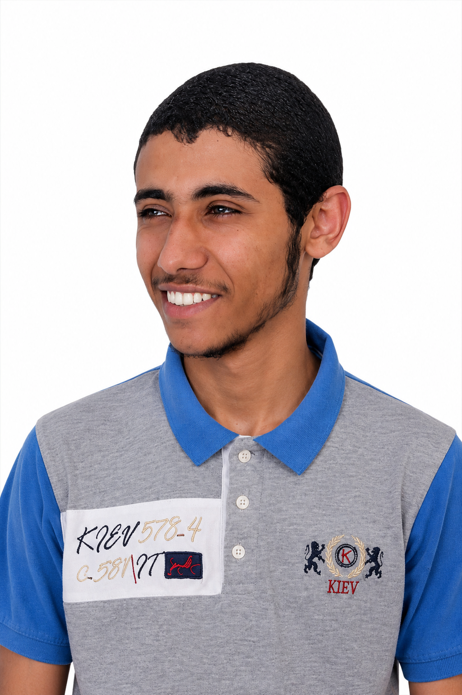

<div align="center">
  

  <h1>Abdaltwab Okasha Elsheikh</h1>

  <h3>Full-stack developer in progress · Computer Science Engineering student</h3>

  <p>A bilingual personal portfolio featuring my background, skills, learning journey, and web development projects.</p>

  <p><a href="https://abdaltwabsayed.github.io/Portifolio/">View the portfolio</a> ·
  <a href="https://github.com/abdaltwabsayed">GitHub profile</a></p>
</div>

---

## About the site

This responsive portfolio introduces me as a fifth-year Computer Science Engineering student at Fayoum University. It brings together my education, current training with the Digital Egypt Pioneers Initiative (DEPI), technical skills, and selected projects.

### Highlights

- Switch between English and Arabic, with the layout adapting to the selected language.
- Toggle between dark and light themes.
- Explore my education, training, skills, language proficiency, and project work.
- Find links to my contact and social profiles.

## Featured projects

| Project | What it is |
| --- | --- |
| [Calculator](https://abdaltwabsayed.github.io/Calculator/) | A browser-based calculator |
| [Rock Paper Scissors](https://github.com/abdaltwabsayed/My-Web-Development/tree/master/rockPaperScissors/rockPaperScissors.html) | A classic game built for the browser |
| [Stopwatch](https://github.com/abdaltwabsayed/My-Web-Development/tree/master/stopwatch/stopwatch.html) | A simple browser stopwatch |
| [World Clock](https://abdaltwabsayed.github.io/World-Clock/) | A clock for checking time around the world |
| [Pokemon Fetcher](https://abdaltwabsayed.github.io/Pokemon-Fetcher/) | A Pokémon-themed web project |
| [House Mocking Drawing](https://github.com/abdaltwabsayed/My-Web-Development/tree/master/HouseMockingDrawing.html) | A drawing made with web technologies |

[Browse more projects](https://github.com/abdaltwabsayed/My-Web-Development/tree/master/)

## Built with

- HTML5
- CSS3
- JavaScript
- Font Awesome and Google Fonts

## Run locally

This is a static site with no build step. Clone the repository and open `index.html` in a browser, or serve the project directory with a local static server.

```bash
git clone https://github.com/abdaltwabsayed/Portifolio.git
cd Portifolio
python -m http.server 8000
```

Then visit `http://localhost:8000`.

## Project structure

```text
.
├── assets/                 # Portrait, project previews, and logo
├── scripts/                # Page interactions, theme, and translations
├── styles/                 # Portfolio styles
├── index.html              # Main portfolio page
└── README.md
```

---

<div align="center">
  Made with care by <a href="https://github.com/abdaltwabsayed">Abdaltwab</a>
</div>
